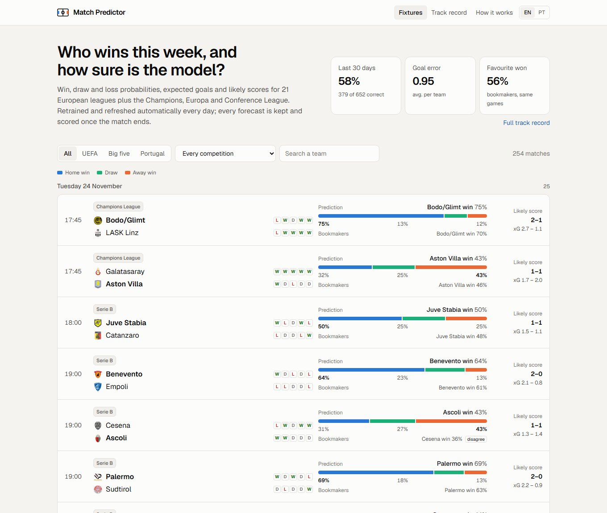
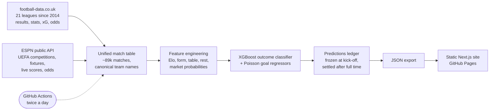
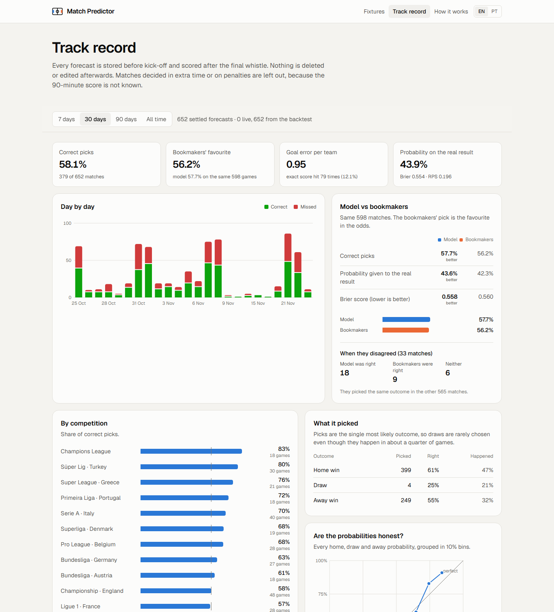
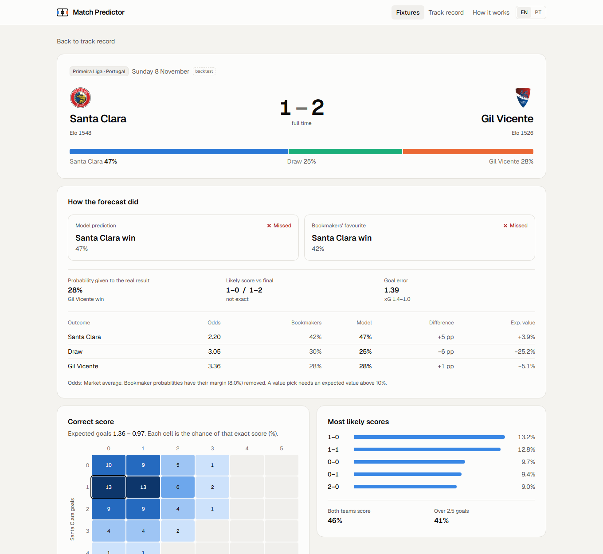

# Football Match Predictor

[](https://github.com/barrosw5/football_match_predicter/actions/workflows/update.yml)
[](https://github.com/barrosw5/football_match_predicter/actions/workflows/ci.yml)


An end-to-end machine-learning system that forecasts football matches in **21 European leagues and the three UEFA club
competitions** (Champions, Europa and Conference League), retrains itself every day, and publishes the forecasts,
together with a **public, tamper-proof track record of every prediction**, to a static website.

**Live site:** https://barrosw5.github.io/football_match_predicter/



## Highlights

- **Fully automated.** A scheduled GitHub Action downloads new results and fixtures twice a day, retrains the model,
  scores finished matches, forecasts the next 7 days and redeploys the site. No server, no manual runs.
- **Honest evaluation.** Forecasts are frozen at kick-off and stored in an append-only ledger
  ([`data/predictions_ledger.csv`](data/predictions_ledger.csv)). The *Track record* page shows how many matches the model
  got right in the last 7/30/90 days, by how much it missed the score, its calibration, and how it compares with the
  bookmakers, including where it loses.
- **Leakage-free features.** Elo ratings, rolling form, league tables, rest days and market prices are computed only from
  information available before kick-off; a unit test changes a match's score and asserts its features don't move.
- **Validated out of sample.** Walk-forward validation over 21,255 matches (2023/24 to 2025/26) matches the
  bookmakers' accuracy and clearly beats Elo-only and base-rate baselines (results below).
- **Model vs bookmakers, match by match.** Every fixture and result shows the model's pick next to the bookmakers'
  favourite; the track record counts who was right when they disagreed.
- **Full score distribution.** Poisson goal models give the correct-score grid, expected goals, both-teams-to-score and
  over/under 2.5 for every fixture.
- **Bilingual site** (English / Portuguese) with club crests, light and dark mode.

## How it works



1. **Data** ([`sources/`](src/football_predictor/sources)). football-data.co.uk provides results, shots, corners, cards,
   bookmaker odds and (from 2026/27) xG for 16 main divisions plus 5 extra leagues. ESPN's public scoreboard API
   provides every UEFA club match since 2014, upcoming fixtures for all competitions, live results and DraftKings
   odds. Downloads are cached; historical seasons are fetched once.
2. **Team names** ([`teams.py`](src/football_predictor/teams.py)). "Atlético Madrid", "Atletico Madrid" and
   "Ath Madrid" must be the same club, while "Red Star Belgrade" must *not* become France's "Red Star" and
   "Real Sociedad II" must not become "Real Sociedad". The matcher combines an alias table, accent-insensitive keys and
   fuzzy matching restricted to clubs of the same country (inferred from each club's home stadium).
3. **Features** ([`features.py`](src/football_predictor/features.py)). 59 features: cross-competition Elo with home
   advantage and margin of victory, form over the last 5/10 games (points, goals, shots, corners, cards, xG), home-only
   and away-only form, league position and points per game, rest days, competition scoring/draw rates and
   margin-free market probabilities. Missing values (no odds for old European games, no xG before 2026) are left as
   missing and handled natively by XGBoost.
4. **Model** ([`model.py`](src/football_predictor/model.py)). An XGBoost multi-class classifier for 1X2, plus two
   XGBoost Poisson regressors for each side's expected goals. The published 1X2 blends the classifier (70%) with the
   Poisson-implied probabilities (30%). Training samples are weighted with a 4-year half-life.
5. **Tracking** ([`tracking.py`](src/football_predictor/tracking.py)). Forecasts can be refreshed until kick-off and
   are frozen afterwards. Results are attached from ESPN (fast) or football-data (fallback). Matches decided in extra
   time or on penalties are excluded because the 90-minute score is unknown.
6. **Website** ([`web/`](web)). Next.js 16 + TypeScript + Tailwind CSS, exported as static HTML (one page per fixture
   and per settled match). Both languages are pre-rendered into every page and an inline script picks one before the
   first paint (saved choice, else the browser language), so there is no flash and no duplicate routes. Charts are
   hand-written SVG components with hover/keyboard tooltips and a colour-vision-deficiency-checked palette.

## Results

Walk-forward validation (each season predicted by a model trained only on earlier seasons) from
[`notebooks/02_modelling.ipynb`](notebooks/02_modelling.ipynb). Lower is better for log loss, Brier and RPS:

| Model | Matches | Accuracy | Log loss | Brier | RPS |
|---|---:|---:|---:|---:|---:|
| Historical frequencies | 21,255 | 44.0% | 1.0721 | 0.6485 | 0.2291 |
| Elo only (logistic regression) | 21,255 | 50.3% | 1.0044 | 0.6005 | 0.2060 |
| Poisson goals model | 21,255 | 51.7% | 0.9894 | 0.5900 | 0.2010 |
| XGBoost classifier | 21,255 | 51.8% | 0.9877 | 0.5891 | 0.2007 |
| **Final model (blend)** | 21,255 | **51.8%** | **0.9871** | **0.5888** | **0.2006** |
| Bookmakers, margin removed (matches with odds) | 19,826 | 51.6% | 0.9893 | 0.5903 | 0.2003 |
| Final model, same matches | 19,826 | 51.4% | 0.9896 | 0.5906 | 0.2004 |

What this means:

- About 52% is typical for 1X2 football forecasting; draws (~25% of matches) are almost never the single most likely
  outcome. The model **performs on par with the bookmakers**, the strongest public benchmark, and beats every simpler
  approach on every metric.
- Expected goals are off by **0.95 goals** per home team (vs 1.04 for a constant-average baseline), and the most
  likely score is exactly right in **13%** of matches.
- "Value bets" (model probability × odds > 1.10) have historically **lost money**: when the model disagrees strongly
  with the market, the market is usually right. The site reports this openly instead of hiding it.

The live numbers for the last 7/30/90 days are on the site's
[Track record](https://barrosw5.github.io/football_match_predicter/performance/) page.

<p align="center">
  
  
</p>

## Project structure

```
├── src/football_predictor/     Python package (all production code)
│   ├── sources/                football-data.co.uk + ESPN clients, HTTP retries & caching
│   ├── config.py               competitions, paths, model settings
│   ├── teams.py                cross-source team-name matching
│   ├── dataset.py              unified match table
│   ├── features.py             leakage-free feature engineering
│   ├── model.py                XGBoost classifier + Poisson goal models
│   ├── evaluation.py           accuracy, log loss, Brier, RPS, calibration
│   ├── predict.py              fixtures to forecasts
│   ├── tracking.py             predictions ledger (freeze, settle, score)
│   ├── export.py               JSON for the website
│   ├── pipeline.py             end-to-end daily run + walk-forward backtest
│   └── cli.py                  `football-predictor` command
├── notebooks/
│   ├── 01_data_exploration.ipynb   sources, coverage, home advantage, goal distributions, market calibration
│   └── 02_modelling.ipynb          validation vs baselines and bookmakers, calibration, feature importance
├── tests/                      pytest suite (features, team matching, metrics, ledger rules, ESPN parser)
├── data/predictions_ledger.csv the public track record (updated by the bot)
├── web/                        Next.js + TypeScript + Tailwind static site
└── .github/workflows/          CI + scheduled update & deploy
```

**Why a package *and* notebooks?** Code that runs unattended every day needs to be importable, tested and versioned,
so it lives in `src/`. The notebooks import that package and are kept for what notebooks do best: exploring the data
and explaining modelling decisions with charts.

## Getting started

Requirements: Python 3.11+ and Node.js 20+.

```bash
git clone https://github.com/barrosw5/football_match_predicter.git
cd football_match_predicter

# Python pipeline
python -m venv .venv
source .venv/bin/activate            # Windows: .venv\Scripts\activate
pip install -e ".[dev,notebooks]"

football-predictor run --backtest-days 90   # first run: downloads ~12 seasons (a few minutes)
football-predictor run                      # daily run: update, retrain, settle, forecast, export
pytest                                      # tests
```

Other commands: `football-predictor data` (only rebuild the match table), `football-predictor train` (hold-out
evaluation, then retrain), `football-predictor export` (rebuild the website JSON from the ledger).

```bash
# Website
cd web
npm ci
npm run dev        # http://localhost:3000
npm run build      # static export in web/out
```

## Deployment & automation

[`update.yml`](.github/workflows/update.yml) runs at 06:15 and 16:15 UTC (and on demand):

1. restores the cached downloads, installs the package and runs `football-predictor run`;
2. commits the updated ledger and JSON files;
3. builds the Next.js site and deploys it to GitHub Pages.

One-time setup: **Settings > Pages > Build and deployment > Source: GitHub Actions**. To seed the track record on a
fresh repository, run the workflow manually with `backtest_days = 90`.

The site is plain static files, so there is no server that can sleep and no uptime pinger is needed. It can also be
hosted on Vercel, Netlify or as a Render *Static Site* (root directory `web`, build command `npm run build`, publish
directory `out`); every bot commit then triggers a redeploy.

## Data sources & credits

- [football-data.co.uk](https://www.football-data.co.uk/): historical results, match statistics, xG and odds.
- ESPN's public scoreboard API: UEFA competitions, fixtures, live results and DraftKings odds. Club crests are loaded
  from ESPN's image CDN and belong to their respective clubs.

Data is used for non-commercial, educational purposes.

## Limitations & ideas

- No team news (injuries, suspensions, rotation) and no line-ups: the main information the market has and the model
  does not.
- xG is only available from 2026/27, so its features will become more useful as seasons accumulate.
- Clubs from countries outside the dataset (e.g. Ukraine, Croatia) are rated from their European matches only.
- Next steps: Dixon-Coles low-score correction, player-level availability data, probability calibration per
  competition.

## Version history

**v2.0 (2026)**: complete rewrite. Python package with tests and CLI; ESPN integration for the UEFA competitions;
leakage-free features; walk-forward validation; prediction ledger and track record; automated daily pipeline; new
bilingual Next.js + TypeScript + Tailwind site.

**v1 (2025)**: single notebook + Flask API. The Understat xG scraper stopped working (and Understat never covered the
Champions League), European matches were silently dropped by an odds filter, and the API ignored team form because of
a missing column. See the git history for the original code.

---

Forecasts are probabilities, not certainties. This project is not betting advice.
