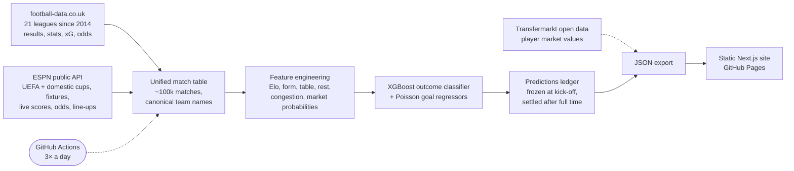

# Football Match Predictor

[](https://github.com/barrosw5/football_match_predicter/actions/workflows/update.yml)
[](https://github.com/barrosw5/football_match_predicter/actions/workflows/ci.yml)


An end-to-end machine-learning system that forecasts football matches in **21 European leagues, 10 domestic cups and
the three UEFA club competitions** (Champions, Europa and Conference League), retrains itself every day, and publishes
the forecasts, together with a **public, tamper-proof track record of every prediction**, to a static website.

**Live site:** https://barrosw5.github.io/football_match_predicter/


## Highlights

- **Fully automated.** A scheduled GitHub Action downloads new results and fixtures three times a day, retrains the model,
  scores finished matches, forecasts the next 7 days and redeploys the site. No server, no manual runs.
- **Honest evaluation.** Forecasts are frozen at kick-off and stored in an append-only ledger
  ([`predictions_ledger.csv`](https://github.com/barrosw5/football_match_predicter/blob/data/predictions_ledger.csv)
  on the `data` branch, updated by the bot). The *Track record* page shows how many matches the model
  got right in the last 7/30/90 days, by how much it missed the score, its calibration, and how it compares with the
  bookmakers, including where it loses.
- **Leakage-free features.** Elo ratings, rolling form, league tables, rest days and market prices are computed only from
  information available before kick-off; a unit test changes a match's score and asserts its features don't move.
- **Validated out of sample.** Walk-forward validation over 23,301 matches (2023/24 to 2025/26, leagues, cups and UEFA) matches the
  bookmakers' accuracy and clearly beats Elo-only and base-rate baselines (results below).
- **Model vs bookmakers, match by match.** Every fixture and result shows the model's pick next to the bookmakers'
  favourite; the track record counts who was right when they disagreed.
- **Full score distribution.** Poisson goal models give the correct-score grid, expected goals, both-teams-to-score and
  over/under 2.5 for every fixture.
- **Club Elo ranking** of ~450 clubs on one scale, with places gained or lost over the last week and month, the
  rating trend and each squad's market value.
- **Match pages with real statistics.** Each team's last 5/10 matches (goals, xG, shots, corners, yellow and red cards),
  line-ups drawn on a pitch in their real formation, goal scorers and cards of finished matches, and each team's
  previous starting XI before a fixture.
- **Team and player pages.** Every ranked club has a page with its full match history since 2014, upcoming forecasts,
  how the model did on its games, Elo and squad-value charts and the current squad; every player has a page with
  profile, market value, season goals/assists and a match-by-match log. A sortable players table (apps, starts, goals,
  assists, shots, shots on target, fouls, cards, market value) per competition, plus ESPN's season leaders.
- **Bilingual site** (English / Portuguese) with club crests and a light / dark theme switch.

## How it works



1. **Data** ([`sources/`](src/football_predictor/sources)). football-data.co.uk provides results, shots, corners, cards,
   bookmaker odds and (from 2026/27) xG for 16 main divisions plus 5 extra leagues. ESPN's public API provides every
   UEFA club match since 2014, 10 domestic cups (FA Cup, EFL Cup, Copa del Rey, DFB-Pokal, Coppa Italia, Coupe de
   France, KNVB Cup, Scottish Cup and League Cup, Taça de Portugal), upcoming fixtures, live results, DraftKings odds,
   line-ups and top scorers. Squad values come from the open
   [transfermarkt-datasets](https://github.com/dcaribou/transfermarkt-datasets) project. Downloads are cached;
   historical seasons are fetched once.
2. **Team identity** ([`teams.py`](src/football_predictor/teams.py)). "Atlético Madrid", "Atletico Madrid" and
   "Ath Madrid" must be the same club, while "Red Star Belgrade" must *not* become France's "Red Star", nor amateur
   "Lille Sud" become Lille in the Coupe de France. ESPN uses one team id per club across all competitions, so ids
   learned from league rosters identify cup and European opponents; names are only a fallback (alias table,
   accent-insensitive keys, same-country fuzzy matching, and no fuzzy matching at all in domestic cups). Transfermarkt
   clubs are linked through matching games (same day, country and score) rather than names.
3. **Features** ([`features.py`](src/football_predictor/features.py)). 62 features: cross-competition Elo with home
   advantage and margin of victory, form over the last 5/10 games (points, goals, shots, corners, cards, xG), home-only
   and away-only form, league position and points per game, rest days and matches played in the last 14 days (league,
   cup and European games all count, so a Champions League side's midweek fixtures are included), competition
   scoring/draw rates, cup / UEFA flags and margin-free market probabilities. Missing values (no odds for old cup
   games, no xG before 2026) are left as missing and handled natively by XGBoost.

   *Tested and left out:* squad market value at kick-off (log loss 0.9467 with vs 0.9462 without, so no gain once
   odds and Elo are in). *Not usable:* starting line-ups, which free sources publish only about an hour before
   kick-off, after the forecasts are made.
4. **Model** ([`model.py`](src/football_predictor/model.py)). An XGBoost multi-class classifier for 1X2, plus two
   XGBoost Poisson regressors for each side's expected goals. The published 1X2 comes from the classifier (blends with the
   Poisson-implied probabilities were validated and no longer help once cups are included); the Poisson models give
   expected goals and the correct-score grid. Training samples are weighted with a 4-year half-life.
5. **Tracking** ([`tracking.py`](src/football_predictor/tracking.py)). Forecasts can be refreshed until kick-off and
   are frozen afterwards. Results are attached from ESPN (fast) or football-data (fallback). Matches decided in extra
   time or on penalties are excluded because the 90-minute score is unknown.
6. **Ranking** ([`ranking.py`](src/football_predictor/ranking.py)). The Elo used by the model, replayed match by match
   to rank every active club now, 7 days ago and 30 days ago, joined with Transfermarkt squad values and their history.
   [`profiles.py`](src/football_predictor/profiles.py) assembles one profile per club (history, forecasts, squad) and
   per player (ESPN squads + appearances from cached line-ups); player profiles are small JSON files loaded by a
   single static player page, which keeps the export to a few thousand HTML files.
7. **Website** ([`web/`](web)). Next.js 16 + TypeScript + Tailwind CSS, exported as static HTML (one page per fixture
   and per settled match): fixtures, match pages (probabilities, correct-score grid, model vs bookmakers, recent form,
   statistics, line-ups), Elo ranking, players, track record and methodology. Both languages and the colour theme are
   chosen by an inline script before the first paint (saved choice, else browser / OS setting), so nothing flashes.
   Charts are hand-written SVG components with hover/keyboard tooltips and a colour-vision-deficiency-checked palette.

## Results

Walk-forward validation (each season predicted by a model trained only on earlier seasons) from
[`notebooks/02_modelling.ipynb`](notebooks/02_modelling.ipynb). Lower is better for log loss, Brier and RPS:

| Model | Matches | Accuracy | Log loss | Brier | RPS |
|---|---:|---:|---:|---:|---:|
| Historical frequencies | 23,301 | 44.4% | 1.0658 | 0.6448 | 0.2325 |
| Elo only (logistic regression) | 23,301 | 51.9% | 0.9898 | 0.5898 | 0.2059 |
| Poisson goals model | 23,301 | 53.4% | 0.9713 | 0.5770 | 0.2005 |
| **Final model (XGBoost classifier)** | 23,301 | **53.4%** | **0.9551** | **0.5717** | **0.1994** |
| Bookmakers, margin removed (matches with odds) | 19,826 | 51.6% | 0.9893 | 0.5903 | 0.2003 |
| Final model, same matches | 19,826 | 51.4% | 0.9902 | 0.5910 | 0.2005 |

What this means:

- About 52-54% is typical for 1X2 football forecasting; draws (~25% of matches) are almost never the single most likely
  outcome. The model **performs on par with the bookmakers**, the strongest public benchmark, and beats every simpler
  approach on every metric.
- Expected goals are off by **0.96 goals** per home team (vs 1.06 for a constant-average baseline), and the most
  likely score is exactly right in **12.4%** of matches.
- "Value bets" (model probability × odds > 1.10) have historically **lost money**: when the model disagrees strongly
  with the market, the market is usually right. The site reports this openly instead of hiding it.

The site's [Track record](https://barrosw5.github.io/football_match_predicter/performance/) page shows the last
7/30/90 days and the whole record: a week-by-week walk-forward backtest since 2023/24 (each week predicted by a model
trained only on earlier matches) followed by the live forecasts, each labelled as such.

<p align="center">
  
  
</p>

## Project structure

```
├── src/football_predictor/     Python package (all production code)
│   ├── sources/                football-data.co.uk, ESPN and Transfermarkt clients, retries & caching
│   ├── config.py               competitions, paths, model settings
│   ├── teams.py                cross-source team-name matching
│   ├── dataset.py              unified match table
│   ├── features.py             leakage-free feature engineering
│   ├── model.py                XGBoost classifier + Poisson goal models
│   ├── evaluation.py           accuracy, log loss, Brier, RPS, calibration
│   ├── ranking.py              club Elo ranking and its movement over time
│   ├── profiles.py             team and player pages (history, squads, appearances)
│   ├── predict.py              fixtures to forecasts
│   ├── tracking.py             predictions ledger (freeze, settle, score)
│   ├── export.py               JSON for the website
│   ├── pipeline.py             end-to-end daily run + walk-forward backtest
│   └── cli.py                  `football-predictor` command
├── notebooks/
│   ├── 01_data_exploration.ipynb   sources, coverage, home advantage, goal distributions, market calibration
│   └── 02_modelling.ipynb          validation vs baselines and bookmakers, calibration, feature importance
├── tests/                      pytest suite (features, team matching, metrics, ledger rules, ESPN parser)
├── data/predictions_ledger.csv seed of the track record (the live one is on the `data` branch)
├── web/                        Next.js + TypeScript + Tailwind static site
└── .github/workflows/          CI + scheduled update & deploy
```

**Why a package *and* notebooks?** Code that runs unattended every day needs to be importable, tested and versioned,
so it lives in `src/`. The notebooks import that package and are kept for what notebooks do best: exploring the data
and explaining modelling decisions with charts.

## Getting started

Requirements: Python 3.11+ and Node.js 20+.

```bash
git clone https://github.com/barrosw5/football_match_predicter.git
cd football_match_predicter

# Python pipeline
python -m venv .venv
source .venv/bin/activate            # Windows: .venv\Scripts\activate
pip install -e ".[dev,notebooks]"

football-predictor run --backtest-days 1250 # first run: downloads ~12 seasons, backtests since 2023/24 (~30 min)
football-predictor run                      # daily run: update, retrain, settle, forecast, export
pytest                                      # tests
```

Other commands: `football-predictor data` (only rebuild the match table), `football-predictor train` (hold-out
evaluation, then retrain), `football-predictor export` (rebuild the website JSON from the ledger).

```bash
# Website
cd web
npm ci
npm run dev        # http://localhost:3000
npm run build      # static export in web/out
```

## Deployment & automation

[`update.yml`](.github/workflows/update.yml) runs at 05:15, 11:15 and 15:15 UTC (and on demand). European matches kick off between
about 11:00 and 20:00 UTC and finish by 22:00, so the first run has every result of the day before and
publishes before the first kick-off, and the other two refresh the odds before the lunchtime and evening games:

1. restores the cached downloads and the track record from the `data` branch;
2. installs the package and runs `football-predictor run`;
3. commits the updated ledger and JSON to the `data` branch (so `main` stays code-only);
4. builds the Next.js site and deploys it to GitHub Pages.

One-time setup: **Settings > Pages > Build and deployment > Source: GitHub Actions**. To seed the track record on a
fresh repository, run the workflow manually with `backtest_days = 1250` (since 2023/24, about an hour).

The site is plain static files, so there is no server that can sleep and no uptime pinger is needed. It can also be
hosted on Vercel, Netlify or as a Render *Static Site* (root directory `web`, build command `npm run build`, publish
directory `out`); every bot commit then triggers a redeploy.

## Data sources & credits

- [football-data.co.uk](https://www.football-data.co.uk/): historical results, match statistics, xG and odds.
- ESPN's public API: UEFA competitions, domestic cups, fixtures, live results, DraftKings odds, line-ups and top
  scorers. Club crests are loaded from ESPN's image CDN and belong to their respective clubs.
- [transfermarkt-datasets](https://github.com/dcaribou/transfermarkt-datasets) (CC0): player market values, used for
  squad values. The public files were last refreshed in mid-2026, so values are shown with their date.

Data is used for non-commercial, educational purposes.

## Limitations & ideas

- No injuries or confirmed line-ups before kick-off (free sources publish line-ups only about an hour before the
  match): the main information the market has and the model does not. Match pages show each team's previous
  starting XI as a hint.
- Squad values are a proxy for budget; club budgets themselves are not published in any open dataset.
- xG is only available from 2026/27, so its features will become more useful as seasons accumulate.
- Clubs from countries outside the dataset (e.g. Ukraine, Croatia) are rated from their European matches only.
- Tried and rejected (see section 8 of the modelling notebook): squad market value as a feature, a Dixon-Coles
  low-score correction (fitted rho about 0) and per-competition recalibration (mixed results, behind
  `config.CUP_CALIBRATION`). Remaining idea: player-level availability data, which needs a paid source.

## Version history

**v2.4 (2026)**: track record judges the winner and the exact score separately (with the chance of the most
likely score); dark-theme variants of club and competition logos; three daily runs (05:15, 11:15, 15:15 UTC)
timed around the European kick-offs; restrained motion (respects reduced-motion); club crest next to every club name;
monthly ticks on the Elo chart; players table covers the whole season (cup matches without published line-ups no
longer use up the download budget) and leaves out the Taça de Portugal.

**v2.3 (2026)**: validation re-run with the cups; the 1X2 now comes from the classifier alone (best out of
sample); Dixon-Coles, squad value and cup recalibration tested and documented as rejected.

**v2.2 (2026)**: players table with market values, competition logos and logo picker, collapsible fixture days
(only the open day is rendered), GitHub icon, rebalanced AI track record page.

**v2.1 (2026)**: domestic cups, club Elo ranking, squad values, team and player pages, line-ups on a pitch,
top scorers, match statistics card, matches-in-the-last-14-days feature, light / dark theme.

**v2.0 (2026)**: complete rewrite. Python package with tests and CLI; ESPN integration for the UEFA competitions;
leakage-free features; walk-forward validation; prediction ledger and track record; automated daily pipeline; new
bilingual Next.js + TypeScript + Tailwind site.

**v1 (2025)**: single notebook + Flask API. The Understat xG scraper stopped working (and Understat never covered the
Champions League), European matches were silently dropped by an odds filter, and the API ignored team form because of
a missing column. See the git history for the original code.

---

Forecasts are probabilities, not certainties. This project is not betting advice.
